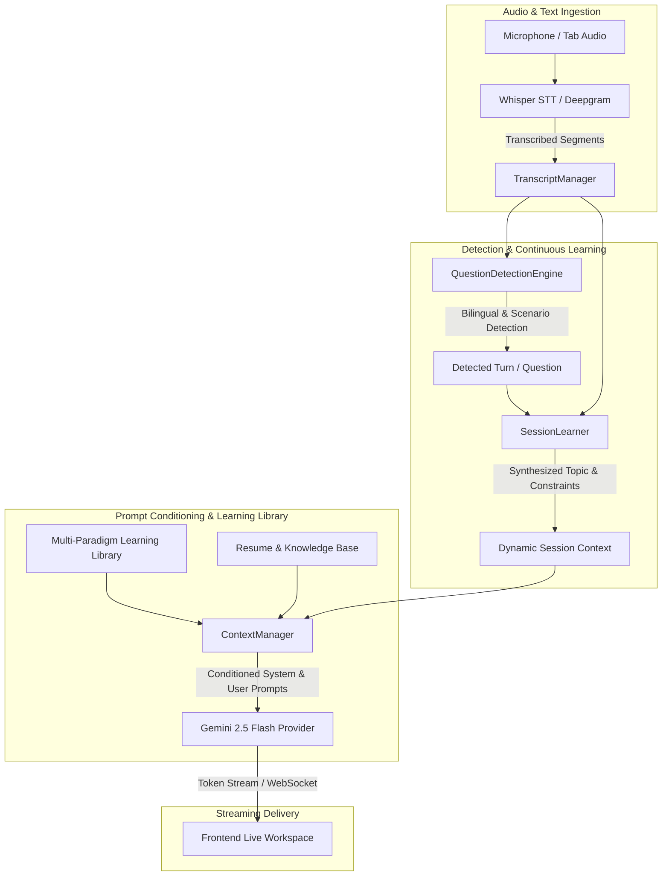

# Conversational Intelligence & Multi-Paradigm Learning Copilot Implementation Plan

> **For agentic workers:** REQUIRED SUB-SKILL: Use superpowers:subagent-driven-development (recommended) or superpowers:executing-plans to implement this plan task-by-task. Steps use checkbox (`- [ ]`) syntax for tracking.

**Goal:** Transform Interview Copilot AI into an adaptive conversational assistant that continuously understands the entire interview dialogue, mirrors English/Hindi/Hinglish speech, synthesizes ongoing conversation constraints, and trains Gemini responses through 5 diverse few-shot learning paradigms.

**Architecture:**
- **Bilingual & Hinglish Turn Detection:** Extends `QuestionDetectionEngine` with Romanized Hindi (Hinglish) and Devanagari Hindi regex cues for questions, system scenarios, constraints, and pleasantry suppression.
- **Dynamic In-Session Context Learner (`SessionLearner`):** Analyzes the evolving transcript and prior Q&A to synthesize active conversation topics, technical constraints established by the interviewer, and language style.
- **Multi-Paradigm Few-Shot Learning Library:** Supplies built-in exemplar pairs across 5 interview paradigms (System Design, Incident Debugging, Behavioral STAR, Handling Pushback, Bilingual Hinglish Technical Dialogue).
- **Context Manager Prompt Conditioning:** Injects learned session constraints, active learning paradigms, and bilingual mirroring rules into Gemini prompts.
- **Frontend Controls:** Exposes learning paradigm toggles and "Bilingual (Hindi + English)" selector in Settings and Session Workspace.

**Architecture Diagram:**



**Tech Stack:**
- FastAPI, Python 3.14, SQLModel, Pydantic, SQLite
- Next.js 15, React 19, TypeScript, Tailwind CSS
- Gemini API (google-genai SDK), Faster-Whisper

**Spec:** [docs/superpowers/specs/2026-11-19-bilingual-hindi-english-design.md](file:///d:/interview-copilot-ai/docs/superpowers/specs/2026-11-19-bilingual-hindi-english-design.md)

---

## Global Constraints

- Never fabricate candidate experience, companies, or projects not in the Resume or Knowledge Base (Grounding Guard).
- Technical terms, architecture patterns, metric names, and code snippets must always remain in standard English even when responding in Hindi/Hinglish.
- Audio capture must remain explicit with visible status indicators; no stealth listening.
- Keep all unit tests passing with zero regressions across the existing 72-test suite.
- Maintain under 1.5s Time-to-First-Token (TTFT) for streaming answers.

---

## Review Focus

1. **Mixed Code-Switching (Hinglish):** Interviewer blends English and Hindi in one sentence (e.g. *"Aapka previous project explain karo aur batayein lock contention kaise solve kiya"*). Expected: Detects as a valid technical turn and answers in fluent technical Hinglish with English engineering terms.
2. **Prior Constraint Retention:** Interviewer previously said *"We cannot use distributed 2PC"*; 3 turns later asks *"How to handle multi-service updates?"*. Expected: In-session learner retains the 2PC constraint so Gemini suggests Saga/Outbox without proposing 2PC.
3. **Hindi Small Talk Suppression:** Interviewer says *"Theek hai, dhanyawad, can you hear me?"*. Expected: Strictly ignored by detection engine; no prompt or answer triggered.
4. **Devanagari vs Romanized Hindi:** Question submitted in Devanagari script (e.g. *"क्या आप ऑथेंटिकेशन और ऑथराइजेशन में अंतर समझा सकते हैं?"*). Expected: Correctly detected as technical and answered appropriately.
5. **Learning Paradigms Configuration:** User toggles off Behavioral STAR but keeps System Design and Hinglish active. Expected: Only selected learning exemplars are injected into Gemini's prompt.

---

### Task 1: Bilingual Hindi & Hinglish Pattern Detection

**Files:**
- Modify: `backend/app/services/question_detection/patterns.py`
- Modify: `backend/app/services/question_detection/engine.py`
- Test: `backend/tests/unit/test_question_detection.py`

**Interfaces:**
- Produces: `HINGLISH_QUESTION_PATTERNS`, `HINDI_QUESTION_PATTERNS`, `HINGLISH_CONVERSATION_CUE_PATTERNS`, `HINDI_CONVERSATION_CUE_PATTERNS`, `HINDI_SMALL_TALK_PATTERNS` in `patterns.py`.
- Consumes: Updated patterns in `engine.py` methods `_classify_question`, `_is_conversational_turn`, and `_is_small_talk`.

- [ ] **Step 1: Write failing tests for Hindi and Hinglish question and scenario detection**

```python
def test_hinglish_and_devanagari_question_detection():
    engine = QuestionDetectionEngine(session_id="s-bilingual-test", conversation_mode=True)
    samples = [
        ("Aapka previous project explain karo.", "technical"),
        ("Kya aap authentication aur authorization mein difference bata sakte ho?", "technical"),
        ("क्या आप ऑथेंटिकेशन और ऑथराइजेशन में अंतर समझा सकते हैं?", "technical"),
        ("Maan lijiye hamare system mein Redis high memory le raha hai.", "conversation"),
        ("Problem yeh hai ki database deadlocks aa rahe hain flash sales ke time.", "conversation"),
    ]
    for text, expected_type in samples:
        ev = engine.process_segment(text, source="tab", now_mono=100.0)
        assert ev is not None, f"Failed to detect: {text}"
        assert ev.question_type == expected_type


def test_hindi_small_talk_suppression():
    engine = QuestionDetectionEngine(session_id="s-hindi-smalltalk", conversation_mode=True)
    small_talk = ["Theek hai", "Dhanyawad", "Haan ji", "Aap sun sakte ho?", "Bahut badhiya"]
    for text in small_talk:
        ev = engine.process_segment(text, source="tab", now_mono=200.0)
        assert ev is None, f"Small talk should be suppressed: {text}"
```

- [ ] **Step 2: Run test to verify it fails**

Run: `$env:PYTHONPATH="backend"; python -m pytest backend/tests/unit/test_question_detection.py::test_hinglish_and_devanagari_question_detection -v`  
Expected: FAIL

- [ ] **Step 3: Implement Hindi and Hinglish regex patterns and update engine**

Add regex sets to `backend/app/services/question_detection/patterns.py`:
- `HINGLISH_QUESTION_PATTERNS`: question starters (`kya aap`, `kaise karenge`, `explain karo`, `batao`, etc.)
- `HINDI_QUESTION_PATTERNS`: Devanagari question words (`क्या`, `कैसे`, `क्यों`, `समझाओ`, `बताओ`)
- `HINGLISH_CONVERSATION_CUE_PATTERNS`: scenario cues (`maan lijiye`, `agar hamare system mein`, `issue yeh aa raha hai`, etc.)
- `HINDI_CONVERSATION_CUE_PATTERNS`: Devanagari scenario cues (`मान लीजिए`, `समस्या यह है कि`)
- `HINDI_SMALL_TALK_PATTERNS`: pleasantries (`theek hai`, `dhanyawad`, `haan ji`, `sun sakte ho`)
Update `backend/app/services/question_detection/engine.py` to check these patterns in `_is_small_talk`, `_classify_question`, and `_is_conversational_turn`.

- [ ] **Step 4: Run test to verify it passes**

Run: `$env:PYTHONPATH="backend"; python -m pytest backend/tests/unit/test_question_detection.py -v`  
Expected: All tests PASS.

- [ ] **Step 5: Commit**

```bash
git add backend/app/services/question_detection/patterns.py backend/app/services/question_detection/engine.py backend/tests/unit/test_question_detection.py
git commit -m "feat: add bilingual Hindi and Hinglish question and turn detection"
```

---

### Task 2: Multi-Paradigm Few-Shot Learning Library

**Files:**
- Create: `backend/app/services/answer_generation/learning_paradigms.py`
- Test: `backend/tests/unit/test_learning_paradigms.py`

**Interfaces:**
- Produces: `LearningParadigm` enum/dataclass and `get_learning_exemplars(active_paradigms: List[str]) -> List[Dict[str, str]]`.
- Consumes: Built-in high-quality few-shot exemplars across 5 paradigms:
  1. `system_design`: Distributed cache failure & eviction strategy.
  2. `incident_debugging`: Microservice latency spike & thread pool exhaustion diagnosis.
  3. `behavioral_star`: Resolving cross-team technical deadlock with quantified business result.
  4. `pushback_handling`: Politely defending asynchronous event-driven design against synchronous REST bias.
  5. `bilingual_hinglish`: System constraint explained in natural technical Hinglish with standard English architecture keywords.

- [ ] **Step 1: Write failing test for Learning Paradigms library**

```python
from app.services.answer_generation.learning_paradigms import (
    AVAILABLE_PARADIGMS,
    get_learning_exemplars,
)

def test_learning_paradigms_retrieval():
    assert len(AVAILABLE_PARADIGMS) == 5
    all_exemplars = get_learning_exemplars(["system_design", "bilingual_hinglish"])
    assert len(all_exemplars) == 2
    assert "Redis" in all_exemplars[0]["ideal_answer"] or "cache" in all_exemplars[0]["ideal_answer"].lower()
    # Check Hinglish exemplar contains bilingual phrasing and English tech terms
    hinglish = [ex for ex in all_exemplars if "bilingual" in ex.get("paradigm", "bilingual_hinglish")]
    assert len(hinglish) == 1
```

- [ ] **Step 2: Run test to verify it fails**

Run: `$env:PYTHONPATH="backend"; python -m pytest backend/tests/unit/test_learning_paradigms.py -v`  
Expected: FAIL with ModuleNotFoundError or import error.

- [ ] **Step 3: Implement `learning_paradigms.py`**

Create `backend/app/services/answer_generation/learning_paradigms.py` with:
- `AVAILABLE_PARADIGMS = ["system_design", "incident_debugging", "behavioral_star", "pushback_handling", "bilingual_hinglish"]`
- Structured exemplars with fields `paradigm`, `title`, `question`, and `ideal_answer` formatted according to strict structured output rules (`**Direct Answer**`, `**Key Points**`, `**Practical Example**`, `**Quick Tip**`).
- `get_learning_exemplars(active_paradigms: Optional[List[str]] = None) -> List[Dict[str, str]]`.

- [ ] **Step 4: Run test to verify it passes**

Run: `$env:PYTHONPATH="backend"; python -m pytest backend/tests/unit/test_learning_paradigms.py -v`  
Expected: PASS.

- [ ] **Step 5: Commit**

```bash
git add backend/app/services/answer_generation/learning_paradigms.py backend/tests/unit/test_learning_paradigms.py
git commit -m "feat: add multi-paradigm interview learning library"
```

---

### Task 3: In-Session Dynamic Context & Constraint Learning Synthesizer

**Files:**
- Create: `backend/app/services/answer_generation/session_learner.py`
- Test: `backend/tests/unit/test_session_learner.py`

**Interfaces:**
- Produces: `SessionLearner.extract_session_learnings(recent_transcript: List[dict], prior_qa: List[dict]) -> SessionLearnings`
  where `SessionLearnings` has:
  - `active_topic: str`
  - `established_constraints: List[str]`
  - `detected_language_style: str` ("english", "hinglish", "hindi")
  - `to_prompt_section() -> str`

- [ ] **Step 1: Write failing test for `SessionLearner`**

```python
from app.services.answer_generation.session_learner import SessionLearner

def test_session_learner_synthesizes_constraints_and_language():
    learner = SessionLearner()
    recent_transcript = [
        {"speaker": "Interviewer", "text": "In our system, we cannot use two-phase commit across microservices."},
        {"speaker": "Me", "text": "Understood, so distributed transactions with locking are ruled out."},
        {"speaker": "Interviewer", "text": "Haan, bilkul. Aur latency SLA sub-50ms hona chahiye."},
    ]
    prior_qa = [
        {"question": "How to handle distributed payments?", "answer": "Use Saga pattern with compensating transactions."}
    ]
    learnings = learner.extract_session_learnings(recent_transcript, prior_qa)
    assert learnings.detected_language_style == "hinglish"
    assert any("two-phase commit" in c.lower() or "2pc" in c.lower() for c in learnings.established_constraints)
    assert any("sub-50ms" in c.lower() or "latency" in c.lower() for c in learnings.established_constraints)
    prompt_str = learnings.to_prompt_section()
    assert "### LEARNED CONVERSATION CONTEXT & ACTIVE CONSTRAINTS" in prompt_str
```

- [ ] **Step 2: Run test to verify it fails**

Run: `$env:PYTHONPATH="backend"; python -m pytest backend/tests/unit/test_session_learner.py -v`  
Expected: FAIL.

- [ ] **Step 3: Implement `session_learner.py`**

Create `backend/app/services/answer_generation/session_learner.py`:
- Constraint extraction heuristics (regexes detecting negatives, requirements, and tech choices: `cannot use`, `must have`, `don't use`, `latency under`, `SLA`, `ruled out`, `strictly`, `nahi use karna`).
- Language style detector (checks for Devanagari script or Hinglish keyword frequency across recent utterances).
- Active topic inference (extracts primary technology keywords e.g. microservices, redis, payment, kafka).
- Formatter `to_prompt_section()` returning clean Markdown bullet points.

- [ ] **Step 4: Run test to verify it passes**

Run: `$env:PYTHONPATH="backend"; python -m pytest backend/tests/unit/test_session_learner.py -v`  
Expected: PASS.

- [ ] **Step 5: Commit**

```bash
git add backend/app/services/answer_generation/session_learner.py backend/tests/unit/test_session_learner.py
git commit -m "feat: add dynamic session context and constraint learner"
```

---

### Task 4: Context Manager Integration & Bilingual Prompt Conditioning

**Files:**
- Modify: `backend/app/models/settings.py`
- Modify: `backend/app/schemas/settings.py`
- Modify: `backend/app/database/connection.py`
- Modify: `backend/app/services/answer_generation/context_manager.py`
- Test: `backend/tests/unit/test_answer_generation.py`

**Interfaces:**
- Produces: `active_learning_paradigms: List[str]` in `AppSettings` (defaulting to all 5 paradigms).
- Consumes: `SessionLearner` and `get_learning_exemplars` in `ContextManager.build_context()` and `build_prompts()`.

- [ ] **Step 1: Write failing test in `test_answer_generation.py` for contextual continuity and bilingual prompt formatting**

```python
def test_context_manager_injects_dynamic_session_learnings_and_paradigms():
    cm = ContextManager()
    ctx = AnswerContext(
        session_id="s-learn-test",
        question_id="q-learn-1",
        question="Aapka previous project explain karo aur database architecture discuss karo.",
        question_type="conversation",
        session_type="technical",
        recent_transcript=[
            {"speaker": "Interviewer", "text": "Hamare paas high-volume write traffic hai aur PostgreSQL use kar rahe hain."},
        ],
        prior_qa=[],
    )
    system_prompt, user_prompt = cm.build_prompts(ctx)
    assert "BILINGUAL & HINGLISH INTERVIEW RULES" in system_prompt
    assert "### LEARNED CONVERSATION CONTEXT & ACTIVE CONSTRAINTS" in user_prompt
    assert "### MULTI-PARADIGM INTERVIEW TRAINING EXEMPLARS" in user_prompt
```

- [ ] **Step 2: Run test to verify it fails**

Run: `$env:PYTHONPATH="backend"; python -m pytest backend/tests/unit/test_answer_generation.py::test_context_manager_injects_dynamic_session_learnings_and_paradigms -v`  
Expected: FAIL.

- [ ] **Step 3: Update `AppSettings`, migration, and `ContextManager`**

- In `backend/app/models/settings.py`: add `active_learning_paradigms: str = Field(default='["system_design","incident_debugging","behavioral_star","pushback_handling","bilingual_hinglish"]')`.
- In `backend/app/database/connection.py`: add additive migration column in `init_db()`.
- In `backend/app/schemas/settings.py`: expose `active_learning_paradigms: List[str]`.
- In `backend/app/services/answer_generation/context_manager.py`:
  - Wire `SessionLearner` in `build_context`.
  - Combine user custom few-shot examples with selected `get_learning_exemplars(active_paradigms)`.
  - Update `build_prompts` to inject `BILINGUAL_RULES` in `system_prompt` and append dynamic session learnings in `user_prompt`.

- [ ] **Step 4: Run test to verify it passes**

Run: `$env:PYTHONPATH="backend"; python -m pytest backend/tests/unit/test_answer_generation.py -v`  
Expected: PASS.

- [ ] **Step 5: Commit**

```bash
git add backend/app/models/settings.py backend/app/schemas/settings.py backend/app/database/connection.py backend/app/services/answer_generation/context_manager.py backend/tests/unit/test_answer_generation.py
git commit -m "feat: integrate dynamic session learnings and learning paradigms into prompt manager"
```

---

### Task 5: STT Bilingual Routing & WebSocket Integration

**Files:**
- Modify: `backend/app/services/transcription/whisper_provider.py`
- Modify: `backend/app/services/transcription/transcript_manager.py`
- Modify: `backend/app/api/websockets/manager.py`
- Test: `backend/tests/unit/test_transcript_manager.py`

**Interfaces:**
- Produces: Mapping `"bilingual_hi_en"` in STT to multi-lingual auto-detection mode without forced single-language lock.
- Consumes: Language parameter sent via WebSocket `{"type": "config", "language": "bilingual_hi_en"}`.

- [ ] **Step 1: Write failing test in `test_transcript_manager.py` for bilingual language config**

```python
def test_bilingual_language_config_maps_to_auto_detection():
    tm = TranscriptManager(session_id="s-bi-lang", language="bilingual_hi_en")
    assert tm.language == "bilingual_hi_en"
    # When passed to STT provider, it routes to auto-detection (language=None in Whisper)
```

- [ ] **Step 2: Run test to verify it fails**

Run: `$env:PYTHONPATH="backend"; python -m pytest backend/tests/unit/test_transcript_manager.py::test_bilingual_language_config_maps_to_auto_detection -v`  
Expected: FAIL if logic missing.

- [ ] **Step 3: Implement bilingual STT routing**

In `backend/app/services/transcription/whisper_provider.py`:
- Map `language in ("auto", "bilingual_hi_en")` to `lang_arg = None` so Faster-Whisper dynamically detects language per segment.
In `backend/app/services/transcription/transcript_manager.py`:
- Accept `"bilingual_hi_en"` as valid language code.

- [ ] **Step 4: Run test to verify it passes**

Run: `$env:PYTHONPATH="backend"; python -m pytest backend/tests/unit/test_transcript_manager.py -v`  
Expected: PASS.

- [ ] **Step 5: Commit**

```bash
git add backend/app/services/transcription/whisper_provider.py backend/app/services/transcription/transcript_manager.py backend/tests/unit/test_transcript_manager.py
git commit -m "feat: support bilingual Hindi-English routing in transcription engine"
```

---

### Task 6: Frontend Multi-Paradigm Learning Settings & Session Workspace UI

**Files:**
- Modify: `frontend/types/index.ts`
- Modify: `frontend/app/settings/page.tsx`
- Modify: `frontend/app/session/[id]/page.tsx`

**Interfaces:**
- Produces: `active_learning_paradigms: string[]` in `AppSettings`.
- Exposes:
  - Multi-paradigm training badges with toggle checkboxes in Settings page.
  - "Bilingual: Hindi + English (Hinglish)" option in Language select dropdowns.
  - Live "Conversation Context & Constraints" chip in the live session workspace.

- [ ] **Step 1: Update TypeScript types in `frontend/types/index.ts`**

Add `active_learning_paradigms: string[];` to `AppSettings`.

- [ ] **Step 2: Update Settings Page (`frontend/app/settings/page.tsx`)**

- Add `<option value="bilingual_hi_en">Bilingual: Hindi + English (Hinglish)</option>` in Default Language dropdown.
- Add "Continuous Multi-Paradigm Learning Modules" panel with checkboxes for:
  - System Design & Trade-offs
  - Incident & Performance Debugging
  - Behavioral STAR with Metrics
  - Handling Interviewer Pushback
  - Bilingual Hinglish Technical Dialogue

- [ ] **Step 3: Update Live Session Page (`frontend/app/session/[id]/page.tsx`)**

- Add `<option value="bilingual_hi_en">Bilingual: Hindi + English (Hinglish)</option>` to the session header language dropdown.
- Display a subtle contextual indicator badge when bilingual mode is active.

- [ ] **Step 4: Verify with Next.js lint and build**

Run: `cd frontend; npm run lint && npm run build`  
Expected: 0 lint errors, successful production build.

- [ ] **Step 5: Commit**

```bash
git add frontend/types/index.ts frontend/app/settings/page.tsx frontend/app/session/[id]/page.tsx
git commit -m "feat: add multi-paradigm training controls and bilingual language selection to UI"
```

---

### Task 7: Full Pipeline Verification & Git Sync

**Files:**
- Test: `backend/tests/pipeline/test_full_pipeline.py`
- Test: `backend/tests/integration/test_foundation.py`

**Interfaces:**
- Runs full backend test suite, verifies live local execution with audio and text, and syncs commits to GitHub.

- [ ] **Step 1: Run full pytest suite across all 72+ tests**

Run: `$env:PYTHONPATH="backend"; python -m pytest backend/tests/ -v`  
Expected: 100% tests PASS.

- [ ] **Step 2: Start background daemons and run live verification**

- Ensure backend (`:8000`) and frontend (`:3000`) daemons are active.
- Submit a mixed Hinglish scenario: *"Maan lijiye hamare Redis cluster mein memory contention ho raha hai, usko kaise handle karoge?"*.
- Confirm Gemini returns a structured, fluent Hinglish answer with English technical keywords.

- [ ] **Step 3: Push to GitHub**

```bash
git push origin main
```
